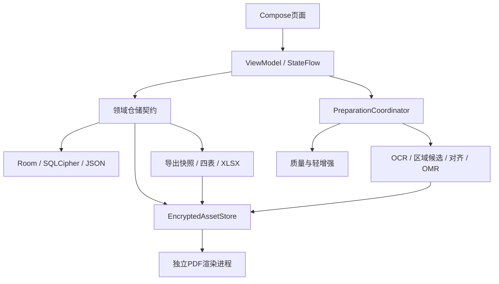

# PhoneForm AI：当前流程、应用结构与 PC 版开发交接

整理日期：2026-10-21（香港时间）  
当前实现：Android `0.9.0-dev`／versionCode `9`，包名 `com.phoneform.ai`，Room schema `7`。  
用途：把本文件交给另一个聊天，作为建立 PC 版的业务与架构基线。**本文件记录现有 Android 实现；PC 版尚未建立，本文不是 PC 功能已完成的声明。**

本文根据当前源码、三份开发文档及 0.9 验收记录核对。即使只转交这一个 Markdown，也可以理解完整流程与必须保留的规则；相对路径链接用于接手同一源码文件夹时继续查阅。

## 1. 产品是什么

PhoneForm AI 将纸本或扫描问卷转成可覆核、可追溯的结构化 Excel 数据。核心不是直接把整份 PDF 交给 AI 猜答案，而是：

**配置要输出什么 → 建立并确认范本 → 一份一份采集 → 按范本提取候选 → 人工覆核 → 固定版本导出。**

当前应用完全离线，不要求账户、服务器或云端模型。AI 分析提出候选，用户决定最终提取哪些题目和区域；复用范本不等于训练模型，不把范本上的答案复制到后续问卷。

### 1.1 必须统一的术语

| 名称 | 含义 |
|---|---|
| 项目 Project | 一种问卷结构及它的采集、覆核、输出配置；不同问卷另建项目 |
| 范本／模板 Template | 用户确认的页面、题目、选项、矩阵、区域和字段关系 |
| 一份问卷 Submission | 一次填写，具有稳定内部 ID 和项目内显示编号，可包含多页 |
| 页面 Page | 一个原件的某一页，或某张图片；正式采集时对应模板的固定页槽 |
| 预计份数 | 可选进度目标，可以提前结束或超额；不是触发识别或导出的门槛 |
| 修订 Revision | 同一份问卷补页、替换、校正等产生的新证据快照，不增加问卷份数 |
| 候选 Observation | 机器读取的结果及来源、证据区域、异常，不是已确认答案 |
| 逐题保存 | 保存本题的人工答案修订，不等于确认整份问卷 |
| 整份确认 | 当前提交修订和答案修订已满足规则，单独保留确认记录 |
| 导出快照 | 固定一批提交、答案、输出规则和生成表格；后续编辑不会修改旧快照 |

### 1.2 全程不变的规则

1. 一个项目处理一种问卷，一份可以多页；不按文件数量猜问卷数量。
2. 简体／繁体界面、问卷语言、导出标题语言分开管理。切换界面语言不改用户输入、题目原文、编号或编码。
3. 原件始终保留；校正图、缩略图、增强图是有来源的派生产物。不得生成式补字、补画或伪造答案证据。
4. 保存、提交、识别完成、完整性、覆核确认分别表示不同状态，不能合并成一个“完成”。
5. 机器候选不能覆盖人工答案；迟到任务不能写回已经改变的图片或提交修订。
6. 空白、不适用、无法辨认、未拍到、未处理分别保存，不能统一变成零分。
7. 失败不显示成功；重复点击及重试必须幂等；取消不丢失已经可靠保存的草稿。
8. 不自动合并同编号、同来源文件或相似题目；不能自动判断混入了其他人的纸页。

## 2. 用户操作总流程


项目内部固定为 **范本／采集／覆核／导出** 四个阶段，可以直接切换。前置条件未满足时显示原因和前往处理的入口；切换阶段不意味着前一阶段已完成。项目资料与输入规则从顶部菜单修改，输出配置集中在导出阶段。

### 2.1 启动、语言与项目列表

- 先完成加密存储初始化，失败时显示标准错误和重试入口，不初始化替代数据库或重建密钥。
- 首次选择简体或繁体并完成引导；设置中可以换语言、重看引导。
- 项目列表使用摘要、搜索和最近更新时间排序；摘要不是每行长期订阅全部工作区。
- 长按项目进入多选；顶部全选／取消全选、已选数量、退出和删除；返回先退出多选。
- 批量删除有两次确认，最终固定项目 ID 集；每个项目分别显示等待、清理中、失败或完成。

### 2.2 三步创建与后续修改

| 步骤 | 用户填写 | 默认／校验 |
|---|---|---|
| 项目信息 | 名称、可选预计份数 | 名称必填；份数留空或正整数 |
| 输入规则 | 问卷语言、编号方式 | 应用生成编号；后续可选相机、图片或 PDF |
| 输出内容 | 提取全部／指定目标、人工填写项、标题语言、个人标识偏好 | XLSX、全部提取目标、不导出个人标识；新建默认标题语言对应创建时界面语言 |

创建步骤共用稳定项目 ID 和同一加密编辑会话，不每步生成新项目。未建立范本时只能预览已知列，真实每份页数与全部题目列待样本确认。

既有项目按分区直接修改，不要求重新走三步。输出配置使用版本比较保存；过期编辑保留输入并提示重新载入，不能用旧表单覆盖新配置。未保存返回可保存、放弃或继续编辑；取消不改变业务数据。

### 2.3 范本：原页 → 圈选 → 字段 → 确认

1. 拍摄或通过系统选择器导入 PDF、JPG、PNG。PDF 先选页；多图与多页最终由用户确认页序。
2. 在应用内打开原页；支持切页、缩放、平移及全屏。区域以校正页面的归一化坐标保存。
3. 默认矩形框选，可拖四角和边；框选模式单指画框、双指缩放／移动，查看模式单指平移。
4. 可整页分析，或框定大范围后“分析选区”；AI 提出题目、题型、选项和区域候选。也可直接框一个字段并手动填写。
5. 覆盖框、题目列表、输出字段联动定位；候选可接受、删除、修改、补充和排序。候选选区本身不等于确认题目。
6. 普通题支持单选、多选、数字、日期、自由文字；Yes/No、Likert 采用单选结构。题目内部 ID 独立于纸面题号，允许不同位置出现相同题号。
7. 简单矩阵圈定一页内的矩形，设置行列和可调分隔线，填写行题目与共用选项，批量生成后逐题修改。当前Android编辑工具为1–20行、2–20列；跨页矩阵分块，复杂语义仍人工。
8. 问卷字段绑定题目，或明确后续人工录入；人工元数据单独保持来源。不能匹配的字段保持问题清单，不能造题补齐。
9. 检查页面、题型、区域、选项编码和映射；不完整可保存草稿，不能确认。确认后显示真实页数、题目数和模板版本。

页面可新增、排序、删除、替换、90°旋转、手动四角校正，说明页可标记不提取但仍占模板页槽。对已标注页旋转、裁切或替换，需清除该页标注并重建，其他页保留。仅调整增强设置不清空几何框。

重新分析保留人工配置和删除决定；局部分析只影响相应范围的待处理建议。已填写样本只建范本，不默认计入正式数据，也不充当空白答案基准。

### 2.4 模板版本与锁定

- 确认版本不可变；尚未采集时可从已确认版本建立新草稿，新版本确认前旧版本有效，放弃草稿不改旧版。
- 开始采集必须有已确认模板，并先处理未确认模板草稿。
- 存在采集草稿时暂时禁止改模板；首次正式提交后项目模板结构永久锁定，检查在仓储事务中执行，旧编辑页不能绕过。
- 正式采集后仍可改名称、预计份数、导出显示标题／顺序、输出标题语言、包含和个人标识偏好；不允许借此新增识别目标、改题目绑定或更换问卷结构。
- 改变问卷结构另建项目；当前没有跨版自动映射。

### 2.5 逐份采集、提交与修订

- 每项目最多一份新问卷采集草稿；每份已提交问卷最多一个修订草稿。
- 当前问卷显示编号固定可见，页数与草稿状态为摘要，页面采用缩略图页槽网格，底部主操作为“提交本份并拍下一份”。
- 应用编号模式的可选纸面编号放进编辑面板；纸面编号模式必须填写。按文本保存，保留 `0001` 等前导零。
- 页槽以模板页 ID 固定。缺第2页时第3页不会前移；不提取字段的说明页也计入完整性。
- 添加页面统一选拍摄、图片、PDF；一次导入只加入当前一份。用户选择来源页与目标页槽；超量必须调整或明确替换，不能静默截断或自动拆多份。
- 相同原件 SHA-256 加 PDF 来源页码只提示同源；重复纸面编号可回原记录或明确再次填写并记原因，不自动合并。
- 至少一页才可提交；缺页列出具体页槽并明确确认，提交后仍为缺页状态。未处理质量提示也要明确处理／继续。
- 原件保存、数据库提交和入队成功后才显示已提交并建立下一份。A 已提交即可准备／提取，用户可以继续采集 B，不等待预计份数。
- 草稿不计已提交份数；放弃草稿不复用显示编号。重复提交返回同一结果，不重复创建提交、修订或任务。

补页、替换、重拍、旋转／校正或改变已提交页处理设置，使用新的修订草稿。新修订提交前旧修订有效；取消不改旧版；提交新修订不增加问卷份数。仅证据、页槽和处理设置均未改变的页面可继承答案，新提交修订仍须重新确认整份。旧文件、答案历史和导出保留。

尚无正式提交时可明确“将已填写样本作为第一份”，先产生独立采集草稿，再按正常编号、页序与提交规则处理。转换有唯一来源记录，重复操作恢复原草稿或提交；正式页使用独立 ID，修改不影响模板。

### 2.6 质量检查与影像准备

- 原件可靠保存并有草稿引用后，再异步检查质量／增强，不阻塞继续添加下一页。
- 原图／校正图／增强图的查看切换只是显示；“使用增强”是独立处理设置。
- 新页面默认轻增强，旧缺省记录保持关闭。处理基于未增强校正图，每次从该图重建，不累计锐化；保持尺寸和坐标，最长边2560。
- 固定带版本参数执行亮度调整、轻度保边降噪、CLAHE和受限锐化；记录实际输入／输出 SHA、处理指纹及引擎版本。
- 质量基于增强前图片；模糊、过暗、阴影／低对比、疑似反光等提示不是判断正确性的保证。空白／稀疏页可为 UNKNOWN，不把白纸当反光，也不保证纸面完整。
- 失败保留原件和校正图，可重试或关增强。警告保留决定绑定当前图片修订、指纹和输入 SHA，替换后不能沿用旧确认。
- 准备任务实际检查文件存在、大小、内容校验、可解码性和派生图，必要时从原件及几何变换重建。准备 READY 不等于已识别或已覆核。

### 2.7 提取、覆核与整份确认

正式提取先将本份页面对齐到固定模板页，再投射确认的提取区域，不能直接照搬不同照片的像素位置。对齐和选项墨迹分析使用未增强校正图；数字／日期 OCR 可辅助使用增强图，双图分歧或质量异常进入人工覆核。

| 类型 | 当前行为 |
|---|---|
| 单选／多选 | 局部标记分析产生候选，歧义、多涂、擦改等要求人工；选项／矩阵候选逐题确认 |
| 数字 | 保留OCR原文与解析候选；不把模糊字符补成数字 |
| 日期 | 完整且有效的 `YYYY-MM-DD`；不补写缺失年月日 |
| 中文／其他自由文字 | 当前人工录入；没有已验收的通用中文手写模型 |
| 人工元数据 | 独立人工填写，不强行绑定纸面题目 |
| 对齐失败 | 显示整页、失败原因，允许人工录入；不能沿用错误裁图区猜答案 |

覆核列表默认待处理，可筛全部、异常、已确认。逐题页面有题目目录、进度、上一题／下一题、保存；来源、修订和OCR原文收入详情。普通尺寸同时展示证据与答案；宽度小于380dp、稳定可用高度小于520dp或字体达到1.5倍，使用原图／填写面板，默认填写并记住选择，键盘不触发反复换布局。

候选与人工答案分开保存。同题被多个输出字段引用，维护一份答案；有效数字／日期候选且无需人工检查时可在整份确认统一接受。冲突、格式错误、未处理项先解决。查看原图没有覆盖框，不代表对齐失败；证据框只读，没有编辑拖点。

保存答案产生新的不可变答案修订；重复保存有操作 ID 防重。可以先保存尚未填完的输入，整份确认时才要求全部目标有效。修改已确认答案使当前整份确认失效，历史确认保留。缺页题目强制为未拍到，不能伪装成空白或零；没有缺页的题目也不能任意选未拍到。

### 2.8 输出配置与 Excel

输出设置独立于原识别／覆核目标：采集后可勾选是否输出、改列名／顺序和隐私属性，不因此重新识别或撤销确认。旧项目里从未纳入采集目标的题目标记未采集，不能通过导出勾选制造答案。

- 六个系统列折叠显示；题目、人工字段、隐私标记和列布局集中编辑，支持稳定列键排序与标题覆盖。
- 默认只包含影像准备READY、当前完整且整份确认的问卷；明确选择含未决／缺页时仍不能绕过影像准备，无任何答案数据的记录也不纳入（无提取目标时例外）。未确认候选附带状态和异常。没有合格记录时报错，不生成假成功空表。
- “导出Excel”依次固定快照、生成并校验内部加密文件，再打开系统保存位置；取消／失败可重试同一快照。
- 后续答案或输出设置变更通过新导出体现，不重写历史快照。历史文件另页查看。

## 3. 当前应用如何构成

### 3.1 三个模块及实际依赖

```text
apps/android/
├─ app/          Android界面、ViewModel、相机、OCR/CV、协调器、Worker
├─ core/model/   Kotlin/JVM领域对象、仓储契约、校验与共享列生成规则
├─ core/data/    Android Room/SQLCipher、JSON持久化、加密文件、PDF、XLSX
├─ gradle/       版本清单、Wrapper
└─ scripts/      构建、模拟器和明确指定设备的真机脚本
```

`:app` 依赖 `:core:model` 和 `:core:data`；数据层实现模型里的仓储契约。`core:model` 是 JVM 模块，依赖 Java17／协程，不是已建立的 Kotlin Multiplatform 或跨语言 SDK。`core:data` 是 Android library，不能因为名字有 core 就整体当桌面库。



### 3.2 启动与手动依赖注入

- `MainActivity` 是启动入口，先展示存储初始化／阻断页面，再进入业务界面；语言偏好通过应用内语言设置应用。
- `PhoneFormApplication.initializeStorage()` 用互斥锁和共享异步初始化，避免页面重建重复创建容器。
- `SecureStorageBootstrap` 完成就绪检查／旧明文升级后创建 `AppContainer`。
- 容器组装项目、模板、提交、识别与答案、图像处理、编辑会话、维护、导出、诊断仓储，以及 `LocalVisionEngine`、`PageImageProcessor`、`PreparationCoordinator`。
- 先恢复删除屏障，再让业务与处理引擎工作；存储未就绪时 Worker 等待／重试。
- 没有网络后端、登录服务或已实现的跨端同步 API。

### 3.3 Android 固定技术版本

| 范围 | 当前配置 |
|---|---|
| 构建 | Gradle8.9、AGP8.7.2、Kotlin／Compose compiler2.1.20、KSP2.1.20-2.0.1 |
| Java／SDK | JBR21运行构建、编译目标Java17；minSdk26、compile/targetSdk35 |
| UI | Compose1.8.3、Material3 1.3.2、Activity1.10.1、Lifecycle/Process2.9.1、Navigation2.9.1 |
| 数据 | Room2.7.2、DataStore Preferences1.1.7；schema7 |
| 图像与调度 | CameraX1.4.2、WorkManager2.10.5、OpenCV4.12.0 |
| OCR | 随APK打包的ML Kit中文及拉丁识别16.0.1；可替换文字读取适配层 |
| 加密 | SQLCipher Android4.17.0；Tink Android1.24.0 Streaming AEAD |

这些是 Android 基线，不是 PC 版依赖选型。PC 版不要为复用本文件而自动升级原 Android 工程或修改已保存数据。

## 4. 领域模型、ID 与持久化

### 4.1 核心对象

| 对象 | 主要职责／关联 |
|---|---|
| `ProjectConfig` | 稳定项目ID、名称、预计份数、问卷语言、编号方式、准备状态、模板关联、创建／更新时间 |
| `OutputProfile` | 项目关联、配置版本、XLSX、范围ALL/SELECTED、标题语言、个人标识偏好、稳定列布局 |
| `RequestedOutputField` | 稳定字段ID、标题、顺序、QUESTIONNAIRE或MANUAL_METADATA、题目绑定及映射状态 |
| `SampleAsset` | 原件ID、IMAGE/PDF、相对路径、解密内容SHA-256／逻辑字节数、拍摄方向 |
| `SamplePage` | 页面ID、原件／来源页、顺序、校正／缩略路径、尺寸、几何修订、变换、不提取标记及处理设置 |
| `TemplateDraft` | 草稿ID、项目ID、编辑修订、基础版本、页面／题目／矩阵／映射 |
| `FormSchemaVersion` | 不可变确认版本、来源草稿、确认时间、完整模板文档 |
| `QuestionDefinition`／`OptionDefinition` | 稳定题目／选项ID、纸面题号、文字、题型、编码、区域、矩阵关联 |
| `MatrixDefinition` | 单页矩形、行列分界和生成的题目ID关系 |
| `Submission`／`SubmissionDraft` | 问卷身份、固定模板版本、显示编号、当前提交修订；新采集或修订草稿和编辑版本 |
| `SubmissionRevision`／`PageRevision` | 不可变本份证据、模板页槽、缺页、身份与重复／缺页确认、页图像修订 |
| `ProcessingJob`／`PageProcessingJob`／`RecognitionJob` | 影像准备、质量／增强、提取任务，各自状态、检查点、目标修订、令牌与重试 |
| `TemplateAnalysisRun`／`TemplateSuggestion` | 样本分析、范围／处理指纹、引擎版本及人工取舍 |
| `TemplateRecognitionProfile`／`PageAlignment` | 固定模板匹配资料、页面变换及对齐状态／原因 |
| `FieldObservation` | 目标键、图片修订、候选、OCR原文／增强原文、证据区域、异常与引擎版本 |
| `AnswerSetRevision`／`ReviewConfirmation` | 不可变答案版本、操作ID和本地操作人；特定提交＋答案版本的确认 |
| `OutputFieldPolicy` | 题目或人工字段的personalIdentifier及exportIncluded，后者默认true |
| `ExportSnapshot`／`ExportArtifact` | 固定记录引用及完整四表内容；文件生成状态、路径、校验值和字节数 |
| `EditorSession`相关仓储 | 加密恢复未保存的敏感表单；不是已保存业务对象 |

当前 `operatorId` 使用本地操作人标识，不是已实现的多账户、研究权限或双人覆核系统。

### 4.2 不能混用的标识和坐标

- 内部项目、题目、问卷、修订等 ID 与界面显示号、纸面题号分开；纸面编号和选项代码是字符串。
- 答案目标键使用 `question:<questionId>` 或 `field:<fieldId>`。同一个题目多个显示别名只指向一份答案。
- 导出列键与答案目标键不同：固定系统键，以及 `field_<fieldId>`、`question_<questionId>`；多选再追加对应选项 ID。不要用翻译后的列标题作为主键。
- 归一化矩形为 `left/top/right/bottom`，原点左上，取值0到1，必须有限且右大于左、下大于上。矩阵分界是在矩阵区域内部的比例。
- PDF `sourcePageIndex`、页面 `position` 等程序序号与显示给用户的页码分开转换，不把显示第1页误写成源索引1。
- `PageTransform` 保存旋转、四角和3×3映射；正式页对齐另存模板到本份的变换。界面缩放／平移不改变这些业务坐标。
- 几何修订与增强指纹分开；切换显示图片也不能产生新的业务修订。

### 4.3 数据库和 JSON

当前 schema7 有23张业务表，详细字段以源码实体及Room导出schema为准，不包含SQLite／Room内部表：

| 组 | 表 |
|---|---|
| 项目与输出 | `projects`、`output_profiles`、`requested_output_fields` |
| 模板 | `template_drafts`、`form_schema_versions` |
| 采集与准备 | `submissions`、`submission_drafts`、`submission_revisions`、`processing_jobs`、`project_collection_state` |
| AI、答案、输出 | `template_analysis_runs`、`template_recognition_profiles`、`recognition_jobs`、`answer_set_revisions`、`review_confirmations`、`output_field_policies`、`export_snapshots`、`export_artifacts` |
| 图像处理 | `image_processing_jobs`、`page_processing_results`、`page_quality_decisions` |
| 管理 | `editor_sessions`、`project_deletions` |

复杂模板、页面修订、观测、答案及快照等由关系记录加 JSON 保存；并非每一个内存对象都有一张独立表。存在没有数据库外键的关联，不能只靠CASCADE删除项目。引用遍历也必须覆盖历史 JSON。

内部编码器中，`TemplateJsonCodec`有`codecVersion:1`，`SubmissionJsonCodec`有`version:1`；其他观测、影像及布局JSON有显式字段和兼容默认，但并非所有载荷都独立带版本号。不能一概按“所有JSON都有version”设计导入器。真实表字段参考[Room schema7](apps/android/core/data/schemas/com.phoneform.ai.core.data.PhoneFormDatabase/7.json)。

Room 保留显式1→7迁移；6→7新增输出布局JSON及包含策略，旧布局默认空、包含默认true。0.9没有新schema迁移。旧JSON兼容默认与处理设置默认OFF均需保留。

**这些是现有内部存储结构，不是已发布的手机↔PC交换格式。** 如果PC采用其他数据库或语言，需要显式映射、迁移和一致性测试，不能直接按本表猜JSON字段协议。

## 5. 仓储边界与事务约束

| 入口／接口 | 接手时要保留的语义 |
|---|---|
| `ProjectRepository.saveProjectSection`／`saveOutputConfiguration` | 分区合并、模板绑定保留、输出版本CAS；旧表单不能覆盖最新输出 |
| `TemplateRepository.beginDraft/saveDraft/confirmDraft/discardDraft/getVersion` | 乐观修订校验、固定版本读取、确认幂等；确认事务写版本、映射和项目关联 |
| `SubmissionRepository.beginSubmission/beginRevision/saveDraft/discardDraft` | 一份新草稿／一个修订草稿，固定模板、来源和预期编辑修订 |
| `submitSubmission(draftId, expectedEditRevision, confirmation)` | 一个事务保存不可变修订、当前指针、唯一准备任务及调度请求，首次提交落实模板锁定 |
| `convertSampleToFirst` | 唯一样本来源，重复恢复原对象，不重复计数 |
| `ImageProcessingRepository` | 只处理已持久化owner/page，核对处理指纹、输入SHA和令牌；旧结果拒绝写回 |
| `ProcessingJobRepository` | 事务领取、检查点、完成／暂停／失败、初始化恢复和待调度代次 |
| `IntelligenceRepository` | 样本建议取舍、识别领取／检查点、读取覆核、`saveAnswer`／`confirmReview`及导出快照 |
| `saveAnswer(...expectedVersion, answer, operationId)` | 当前提交／答案版本检查；不可变新答案版本，重复操作幂等，不能覆盖新人工输入 |
| `confirmReview(...expectedVersion, operationId)` | 校验全部目标，绑定特定提交与答案版本；保存题目不自动调用它 |
| `createExportSnapshot(projectId, includeUnresolved, operationId)` | 固定纳入范围及四表内容，重复使用同一操作ID返回同一快照 |
| `ProjectMaintenanceRepository` | 删除预览、批量事务登记、持久屏障、后台清理、共享文件保护及统计 |
| `EditorSessionRepository`／`DiagnosticsRepository` | 分别处理加密未保存输入和只读白名单诊断，不冒充业务保存 |

异步相机、导入、分析及增强回调绑定项目、草稿／提交、编辑修订、图片修订与处理指纹。切页、切项目、重拍、删除后不满足身份的结果必须拒绝，不能仅凭“当前打开的是哪个项目”决定写入。

## 6. 任务、状态和恢复

### 6.1 分开显示的状态

| 维度 | 当前含义 |
|---|---|
| 项目准备 | `AWAITING_SAMPLE`、`TEMPLATE_DRAFT`、`TEMPLATE_CONFIRMED` |
| 采集模式 | `COLLECTING`、`BACKGROUND_ALLOWED` |
| 准备／图像／识别任务 | 分别维护 `QUEUED`、`RUNNING`、`PAUSED`、`FAILED`、`READY`、`SUPERSEDED` |
| 对齐 | `ALIGNED`、`FAILED`、`MANUAL` 是数据状态；不意味着全部都有现成的人工对齐编辑器 |
| 答案 | `UNHANDLED`、`VALUE`、`BLANK`、`NOT_APPLICABLE`、`UNREADABLE`、`NOT_CAPTURED` |
| 答案来源 | `MANUAL`、`MACHINE_ACCEPTED`、`INHERITED`，另保留humanEdited |
| 导出文件 | `GENERATING`、`READY`、`FAILED` |
| 项目删除 | `WAITING`、`CLEANING`、`FAILED`、`COMPLETE` |

问卷完整性以固定模板页槽缺失情况判断；没有提取字段的页面也计算。排队数、缺页数、待覆核数等可以交叉，不能相加冒充问卷总数。

### 6.2 当前调度方式

`PreparationCoordinator` 共享一个重型执行互斥：图像检查／增强、样本分析、影像准备及提取协调使用同一执行器，拍摄／导入落盘优先，按页和阶段让出资源。样本分析与草稿图像任务仅前台运行。

采集中App退后台在安全检查点暂停；用户明确“结束本轮并继续后台准备”后，持久化后台资格，再安排WorkManager普通工作。再次采集撤回资格。后台使用唯一链 `APPEND_OR_REPLACE` 及数据库待调度／代次信息，调度失败不丢任务；启动、回前台及Worker边界再核对。

任务写回核对进程会话、执行令牌、当前提交／图片修订和输入指纹。新修订把旧未完成任务标为SUPERSEDED；每个进程只初始化恢复一次，不在每次页面重建重置RUNNING任务。一次OCR内部不能续算，中断时重做该页未完成阶段。

PC端保留这些语义；窗口最小化、关闭窗口、退出进程、休眠及重启的产品行为需要另行定义，不能把Android的“退后台暂停”直接等同于PC最小化暂停。

## 7. OCR、图像与 PDF 的当前实现

- `LocalOcrEngine.kt` 提供文字读取适配层和bundled ML Kit实现；保留文字块、行、元素的真实区域。
- `TemplateCandidateDetector` 使用文字、题号、选项位置、形状与空间分组提出整页／局部候选。双栏同题号不自动合并，复杂矩阵／陌生版式仍人工。
- `OpenCvGeometry` 和 `LocalVisionEngine` 进行特征匹配、RANSAC单应变换与几何合理性检查，再投射题目区域和分析标记／数字／日期。
- `PageImageProcessor` 负责增强前质量报告和固定参数轻增强；对齐与OMR不使用增强图作为事实依据。
- 没有已接入的通用VLM或中文手写模型；名称含AI不代表所有题目／文字可自动理解。

### 7.1 PDF 隔离为什么需要保留

0.8曾在API26发现同一系统PDF渲染进程拒绝损坏／加密PDF后，后续正常PDF也可能失败。0.9的统一 `PdfDocumentReader`／`PdfDocumentSession` 使用每份PDF一个不导出的独立隔离进程：

1. 父进程持有项目／文件读取租约，将随机解密描述符交给子进程；子进程不初始化数据库、密钥、模型或后台任务。
2. 缩略图、选中正式页、原件预览及重建都走同一路径；页面PNG通过可靠管道返回，不用大型Bitmap Binder或明文磁盘暂存。
3. 父进程核对会话／请求、完整数据、尺寸、摘要及成功终态后，才写入加密产物并建立有效引用。
4. 取消／关闭释放资源，等待子进程退出，再开始下一份；不能仅依靠解绑清空原生状态。迟到结果无效，等待期间不持有数据库事务。
5. Android连接保护10秒、打开／单页60秒、关闭／取消等待5秒；这些是故障上限，不是性能承诺。

PC不是直接使用Android的PdfRenderer、Binder或代理描述符，而是需要实现等效PDF适配和隔离、取消、随机读取及完整性语义；不得因移植不便降级为永久明文暂存或共享一个被错误污染的渲染进程。具体桌面PDF引擎尚未选定。

## 8. 本地数据保护与项目管理

### 8.1 数据与密钥

- 数据库：Room接SQLCipher Android4.17.0。数据库随机密钥与文件密钥集独立，由Android Keystore AES-GCM主密钥包装，包装结果在禁止备份私有目录。
- 文件：Tink Streaming AEAD，固定 `AES256_GCM_HKDF_1MB`；支持分段认证及随机读取，原件SHA和逻辑大小针对解密内容计算。认证附加数据绑定规范相对路径（`PhoneForm/file/v1/<relativePath>`），不能任意移动／改名密文后仍假定可以解密。
- 覆盖数据库、原件/PDF、派生图、缩略／增强图、拍摄／导入暂存、编辑恢复数据和内部XLSX。语言与引导继续在DataStore。
- CameraX内存JPEG直接加密；Bitmap／OCR／OpenCV读解密流／内存；PDF不落明文副本。
- 新文件先临时加密写入、校验、原子提交，再建立有效数据库引用；不能保存指向半文件的页面。
- 系统SavedState只保存编辑会话ID及轻量导航，敏感未保存输入放加密编辑会话；保存失败保留输入。
- 密钥不可用时阻断并允许重试，不能重新生成密钥覆盖旧项目；没有App密码／生物识别额外步骤，也没有备份／恢复。

**PC无法通过复制手机数据库和密文目录就获得项目。** 当前密钥受Android设备保护，没有已实现的跨端导入、密钥交换或项目备份包。XLSX是输出结果，不是可恢复项目的备份。PC端的系统密钥保护与任何数据交换都要单独设计和验证。

### 8.2 升级、删除、统计

- 明文转加密与schema迁移分开管理：冻结旧清单、检查空间、独立代次复制核验、原子切换，然后清理旧数据库/WAL/SHM及明文文件。
- 中断可恢复；切换前不删原数据，切换后不回退明文；旧文件待清理与就绪分别显示。旧缺失引用列异常，新增校验差异阻止切换。
- 永久删除需要两次确认，无回收站。批量先事务登记全部固定项目ID的删除意图，再设屏障和等待租约，不在事务里长时间等待。
- 仓储保存、任务领取、异步回调均检查删除状态；清理全部相关表及历史JSON引用，按物理文件去重，仍被其他项目／历史引用的文件保留。
- 删除失败可重试，进程重开继续；最终留下不含名称／答案／文件清单的最小墓碑，旧页面不能Upsert复活项目。不取消其他项目共用的工作链。
- 用户外部导入原件和已另存Excel不删除。存储页显示原件、派生、导出、暂存及共享数据库，不虚构项目数据库分摊。
- 当前暂存清理限staging／captures／tmp或`.part`等命名空间，同时要求超过24小时、无引用且无活动租约。引用解析失败或路径异常时停止破坏性清理，不按文件年龄自动删原件、历史或内部导出。

### 8.3 诊断和离线边界

设置及存储初始化失败入口均有设备与诊断。只读显示版本、系统／型号／ABI、内存、空间、存储状态、schema和分阶段任务汇总；数据库不可读显示未知而非零。

报告先预览并固定本次内存快照，再由用户选择位置保存版本化JSON；取消／失败不报成功。字段白名单不含项目名、题目、答案、纸面编号、图像、文件路径、设备唯一ID、密钥或原始日志；不自动上传。

当前Android无INTERNET或广泛存储权限、备份关闭。不能把“离线”写成所有安全、硬件密钥或发布要求已经满足。

## 9. Excel 输出契约（PC版必须对齐）

### 9.1 固定六列与可选身份列

| 稳定列键 | 值的意义 |
|---|---|
| `submission_id` | 项目内递增显示编号，导出按文本保留，不是内部UUID |
| `record_id` | 稳定内部问卷ID |
| `review_status` | 当前覆核状态 |
| `submission_revision` | 本次使用的提交修订ID |
| `template_version` | 固定模板版本ID |
| `completeness` | 当前页槽完整性 |
| `respondent_id`（可选） | 纸面／受访者编号，仅允许导出个人标识时纳入 |

六个系统列始终在前；身份列按规则追加。之后是用户字段顺序，再加入ALL模式下尚未包含的题目；稳定布局可覆盖数据列标题与顺序。已映射题目不再生成一份“全部题目”重复列，但用户明确配置的别名字段可以引用同一答案。

多选按选项展开。相同题目全部别名及子列共用包含／隐私规则，重复显示标题按稳定键分配后缀，移动列不改变后缀归属。预览与实际文件共用 `TemplateColumns`，不能各写一套列逻辑。

### 9.2 四张工作表

| 表 | 内容 |
|---|---|
| `Responses` | 一行一份，固定状态列与已纳入的数据列；不是一页一行 |
| `Codebook` | 稳定列键、标题、目标、题型、选项文字／编码和多选表达 |
| `Review_Flags` | 答案状态、未决原因、缺页、质量等异常与来源 |
| `Summary` | 快照、输出版本、纳入／排除、未决和隐私选项等摘要 |

四表统一应用包含与人工标记的个人标识规则；默认排除纸面编号和已标记字段。不能声称自动识别所有自由文字中的个人资料。

有效多选中选项写1，未选项写0；整题缺失留空并记原因，不能展开成全0。纸面编号、代码、中文和公式形状的用户文字按文本；用户输入不作为公式执行。数字在15位有效精度及Excel量级范围内才写数字，否则保存精确文本并标记；日期按明确年月日文本保存。当前writer限制每表1,048,576行（含标题）、16,384列、单格32,767字符，超限报错，不静默截断。

`ExportSnapshot` 当前已经保存完整四表内容及纳入提交／答案／确认引用。`ExportArtifact` 则记录文件生成状态和SHA；二者不是同一对象。流式OOXML写入内部加密文件并校验后，才向系统选择位置复制解密流，外部Excel是普通文件。取消另存不删除内部可重试文件。

当前快照包含全量四表内容，writer流式写文件不等于整条导出链路恒定内存，也不代表接近Excel格式上限的数据规模已通过压力验收；PC大项目需要另测快照构建、内存和恢复。

## 10. PC 版可复用什么、需要替换什么

下表是迁移边界，不是已选定的桌面技术栈。目标操作系统、界面框架、OCR／PDF运行时及密钥方案仍由下一个开发任务确认并实测。

| 部分 | 可以延续 | PC侧必须处理 |
|---|---|---|
| 业务模型与校验 | ID、修订、缺失状态、锁定、映射和幂等规则 | 选择同JVM复用或等价重写；保持行为测试 |
| 项目／模板／提交／答案仓储 | 事务边界、CAS、固定版本、删除屏障 | PC数据库、迁移和序列化实现，不复制Android Room调用 |
| 界面 | 四阶段、三步创建、原页圈选、证据与填写联动 | 鼠标／键盘、窗口尺寸、焦点、滚动和快捷定位；不照搬手机dp布局 |
| OCR | 可替换读取接口、文字层级／区域及失败转人工 | Android ML Kit适配不能当作桌面OCR二进制；需选离线引擎并重新验收 |
| OpenCV与图像 | 处理顺序、几何／OMR原则、阈值及回归集 | 目标系统原生库／内存格式／资源管理；重新校准，不承诺同准确率 |
| PDF | 单文档隔离、随机访问、取消、完整管道与旧结果拒绝 | 桌面PDF引擎及子进程适配；损坏／密码PDF连续恢复实测 |
| 文件与密钥 | 加密覆盖、逻辑SHA、原子提交、随机读取契约 | PC系统密钥存储与生命周期；不能使用手机Keystore别名解密桌面数据 |
| 调度 | 单重型执行器、检查点、令牌和调度代次 | 桌面生命周期与持久任务；WorkManager是Android实现，不能直接使用 |
| XLSX | 列计划、四表、冻结快照、文本／隐私规则 | 逐文件评估JVM writer复用或等价流式写入，并独立对账 |
| 相机／文件入口 | 一次导入一份、选页与固定页槽 | 桌面文件选择；扫描器／摄像头／批量拆份是新范围，需独立确认 |
| 诊断与删除 | 白名单、版本快照、租约、共享引用和墓碑 | PC只读设备适配及文件系统错误／并发删除测试 |
| 手机协作 | 当前只有逻辑模型可作为共同基线 | 当前没有同步、备份或项目交换包；不能默认具备USB导项目能力 |

若PC希望支持“一个PDF里有多个人的问卷”或一次拖入整个文件夹，必须新增显式分组／页槽确认规则；不能改变现有的一次导入当前一份语义后仍宣称兼容。

### 10.1 尚待接手者确认的PC范围

1. 只做Windows，还是同时支持macOS／Linux；安装形式和最低系统。
2. 独立桌面问卷处理工具，还是与Android交换完整项目；后者需要新的安全交换协议。
3. 第一版是否仅PDF／图片导入；扫描仪、桌面相机和跨份批处理是否另期。
4. 离线OCR、PDF、图像及密钥运行时如何选择、随包资源和许可如何核对。
5. 窗口关闭／最小化／休眠期间是否继续处理，如何明确停止与恢复。
6. PC自己的加密、安装更新、备份恢复是否纳入本期；不借“桌面本地”省略数据保护。

### 10.2 可供下一聊天拆解的实施顺序（尚未实施）

| 阶段 | 要建立的闭环 | 通过后才继续 |
|---|---|---|
| PC-A 基础 | 语言、加密初始化、项目三步配置、持久化和分区修改 | 重启恢复、保存失败和旧表单冲突 |
| PC-B 范本 | PDF／图片原页、整理、缩放圈选、人工题目／矩阵、映射和确认 | 坐标、版本、PDF失败隔离及结构锁定 |
| PC-C 逐份采集 | 固定页槽、编号、幂等提交、修订、单执行器和检查点 | A提交继续B、缺页／重复、退出恢复和迟到写回 |
| PC-D 提取覆核 | 本地OCR／CV适配、候选、证据、逐题保存和整份确认 | 真值与候选分开、人工保护、全部缺失状态 |
| PC-E 输出管理 | 四表、稳定列、隐私、快照／文件重试、删除和诊断 | 独立Excel对账、实际Excel打开、故障／恢复验收 |

这只是供拆分工作的顺序，不代替PC正式方案，也没有未经验证的工期、准确率或吞吐承诺。原路线中桌面相关任务为P4-06；不要因为有交接文档就将PC实现标完成。

## 11. 已验证的事实与仍未完成的范围

### 11.1 当前Android证据

| 范围 | 实际情况 |
|---|---|
| 版本 | 0.9.0-dev/v9，schema7；APK 211,658,853字节 |
| APK SHA-256 | `9defd6b76272e1da32edc5b3634e2f68ef37ec7b2525dd169cb7c59498f2786e` |
| 构建 | 最终构建成功；102项JVM，Lint0 Error/Fatal、116 Warning |
| 模拟器 | API26／35各20轮PDF连续错误后恢复；数据／连续迁移／Worker各150项通过 |
| App回归边界 | 完整候选批次73/74，相机拒绝前置条件失败后在全新环境通过；最终定点与截图单列，不能说最终一次全量全绿 |
| 真实手机 | SM-S9280／Android16/API36／arm64；同签名0.7→0.9/schema6→7保留旧数据 |
| 手机闭环 | 简繁各10份合成问卷，经真实导入／提取任务后按人工基准保存覆核和生成Excel；四表874格独立对账 |
| 手机稳定性 | PDF8项含20轮、异常材料9场景、两项定向界面与应用进程重开通过；锁屏导致首轮检查中断记录保留 |
| 数据保持 | 手机升级核对23表1449行583历史文件及密钥设置；后续进程重开另核对当前数据 |

手机合成闭环不是OCR自动正确率测试，也不是用户已经手动点完全部20份。资料全部是合成内容；不把真实PDF中有歧义的回答作为真值。

### 11.2 仍待开发／验证

- 通用中文手写候选、局部VLM、复杂陌生版式／矩阵语义、跨印刷版次自动映射。
- 自动拍摄、自动裁边及真实纸本拍摄质量／真实细勾擦改阈值校准。
- 跨份批量拆分、完整项目手机↔PC交换／同步、扫描器接入。
- CSV／JSON业务导出、SPSS、量表计分、双人覆核、多账户权限、目标Excel模板映射。
- 备份恢复和密钥恢复；当前卸载、清数据或丢密钥无法恢复。
- 当前版本原生Microsoft Excel实际打开及“无修复提示”；openpyxl通过不能替代。
- 完整手动闭环、手机系统重启／凭据锁定与首次解锁安全、长期后台、低存储／热／电量、外部信号强杀等完整故障和发布矩阵。

上述功能不能在PC版首页用模拟成功结果冒充实现。现有总路线仍为37个编号：2完成、22进行中、13未开始；子项通过不关闭整个阶段。

## 12. PC版最少应保留的验收场景

1. 无网络首次启动，必要OCR／图像资源可用；模型缺失或初始化失败有真实错误，仍可按设计人工处理。
2. 简繁切换不改姓名、文字、纸面编号、代码、修订和任务。
3. 确认模板前阻止无区域、无编码、无映射；采集后旧编辑页不能改锁定结构。
4. A提交即可处理且继续B，预计份数不是门槛；重复点击不重复计数。
5. 缺中间页仍保持页槽；同源、同编号不自动合并，超量不静默截断。
6. 错页／透视／偏移／旋转先对齐，失败显示整页和人工路径，不用错误裁图。
7. 取消PDF、子进程死亡、坏／密码PDF后正常PDF继续可用；不泄露租约或有效半文件引用。
8. 重拍／补页产生新修订，旧任务无权写回，人工答案与旧导出不变。
9. 单题保存与整份确认分开；修改答案撤销当前确认；缺失状态不写成0。
10. 输出选择／列名／顺序不重识别或删答案，固定列、重名、多选、前导零、文本与隐私四表一致。
11. 导出中断或取消位置可重试同一快照，后续编辑只影响新导出；实际Excel打开另取证。
12. 加密密钥错误、密文篡改、低空间或升级中断不能清空数据或降级明文。
13. 删除与导入／预览／识别／保存并发，迟到回调和旧Upsert不能复活项目，共享及外部文件保留。
14. 窗口布局、键盘／鼠标、字体放大、深色和应用重开可操作；不把截图成功当整份确认。

## 13. 接手源码时的入口索引

以下路径均相对本文件所在项目根目录。若另一个聊天只有本文件而没有源码，请明确向用户索取源码或相应文件，不能声称已读源码或已完成Android兼容验证。

| 要查看的内容 | 入口 |
|---|---|
| Android构建／测试说明 | [apps/android/README.md](apps/android/README.md) |
| 当前事实与路线 | [目前进程.md](目前进程.md)、[工作计划.md](工作计划.md)、[待开发.md](待开发.md) |
| 启动、导航与容器 | [MainActivity.kt](apps/android/app/src/main/java/com/phoneform/ai/MainActivity.kt)、[PhoneFormUi.kt](apps/android/app/src/main/java/com/phoneform/ai/PhoneFormUi.kt)、[PhoneFormApplication.kt](apps/android/app/src/main/java/com/phoneform/ai/PhoneFormApplication.kt) |
| 项目配置／列表／工作台 | [ProjectEditorScreen.kt](apps/android/app/src/main/java/com/phoneform/ai/ProjectEditorScreen.kt)、[ProjectListScreen.kt](apps/android/app/src/main/java/com/phoneform/ai/ProjectListScreen.kt)、[ProjectWorkspaceScreen.kt](apps/android/app/src/main/java/com/phoneform/ai/ProjectWorkspaceScreen.kt) |
| 模型、状态、列与校验 | [core/model模型目录](apps/android/core/model/src/main/kotlin/com/phoneform/ai/core/model)；特别是Models、Templates、Collections、Recognition、ImageProcessing、ProjectMaintenance及Repositories |
| 数据库、迁移、JSON／仓储 | [core/data目录](apps/android/core/data/src/main/kotlin/com/phoneform/ai/core/data)、[PhoneFormDatabase.kt](apps/android/core/data/src/main/kotlin/com/phoneform/ai/core/data/PhoneFormDatabase.kt) |
| 原页与矩形编辑 | [template目录](apps/android/app/src/main/java/com/phoneform/ai/template) |
| 逐份采集 | [collection目录](apps/android/app/src/main/java/com/phoneform/ai/collection) |
| 覆核／输出界面与ViewModel | [review目录](apps/android/app/src/main/java/com/phoneform/ai/review) |
| OCR/CV/增强 | [recognition目录](apps/android/app/src/main/java/com/phoneform/ai/recognition) |
| 持久协调器／Worker | [PreparationCoordinator.kt](apps/android/app/src/main/java/com/phoneform/ai/processing/PreparationCoordinator.kt) |
| PDF隔离 | [PdfDocumentReader.kt](apps/android/core/data/src/main/kotlin/com/phoneform/ai/core/data/PdfDocumentReader.kt)、[PdfRenderService.kt](apps/android/core/data/src/main/kotlin/com/phoneform/ai/core/data/PdfRenderService.kt) |
| 加密与启动 | [EncryptedAssetStore.kt](apps/android/core/data/src/main/kotlin/com/phoneform/ai/core/data/EncryptedAssetStore.kt)、[SecureStorageBootstrap.kt](apps/android/core/data/src/main/kotlin/com/phoneform/ai/core/data/SecureStorageBootstrap.kt)、[SecureStorageKeys.kt](apps/android/core/data/src/main/kotlin/com/phoneform/ai/core/data/SecureStorageKeys.kt) |
| XLSX | [ExportSheetBuilder.kt](apps/android/core/data/src/main/kotlin/com/phoneform/ai/core/data/ExportSheetBuilder.kt)、[XlsxWriter.kt](apps/android/core/data/src/main/kotlin/com/phoneform/ai/core/data/XlsxWriter.kt)、[ExportFileStore.kt](apps/android/core/data/src/main/kotlin/com/phoneform/ai/core/data/ExportFileStore.kt) |
| 当前验收与截图 | [0.9构建／模拟器记录](docs/android-stability-validation.md)、[真机记录](docs/android-phone-v09-validation.md)、[截图索引](docs/evidence/v09-ui/README.md) |

### 13.1 可转交的测试材料

- [独立合成试用包](output/trial-v07/README.md)：简繁两套，每套两页模板、10份填写PDF及图片、人工真值、列映射、异常文件；历史v07包名是固定材料身份，不是只适用于旧App。
- [合成生成器](scripts/generate_trial_v07.py)和[独立Excel核对器](scripts/verify_trial_exports_v07.py)：可作为PC等价验收参考，不把人工回填真值的脚本当成识别能力。
- [本轮手机实际Excel](output/trial-v09-phone-results/README.md)：供列、编码、隐私和显示对比，不能还原完整项目。
- 两份真实候选 `Test_2_CN.pdf`、`Test_1_ENG.pdf` 只供授权本地核查；不是可分发测试包，不能修改原件、打包个人资料或把歧义答案当真值。结构说明见[样本清单](docs/sample-candidates.md)。

只发本文给新聊天即可先做产品与架构讨论；实现阶段若要严格对齐，另附 `apps/android` 源码、上述合成包和验收记录。不要转交手机数据库、noBackup密钥、用户原件或整份开发缓存来替代正式交换方案。

## 14. 可直接附给下一聊天的任务说明

> 请以本文件为PhoneForm AI现有Android 0.9.0-dev的交接基线，为PC版开展设计与实现。先区分现有能力、待验证能力和PC新增范围，确认目标系统及PC是独立运行还是与手机交换项目，再选桌面技术。保留四阶段流程、原页圈选、逐份幂等提交、固定模板页槽、不可变修订、人工答案保护、四表Excel、隐私和加密／删除语义。不要假设Android ML Kit、Keystore、Room、WorkManager或PdfRenderer可直接作为PC组件；不要假设已有项目同步、备份或手写模型。若获得源码和合成材料，请先核对模型／仓储／列规则并建立等价验收，再按阶段交付真实可运行的PC闭环，不用模拟识别或假导出代替实现。PC的具体功能范围、技术选择、速度与准确率都应以用户确认和实际验证为准。
