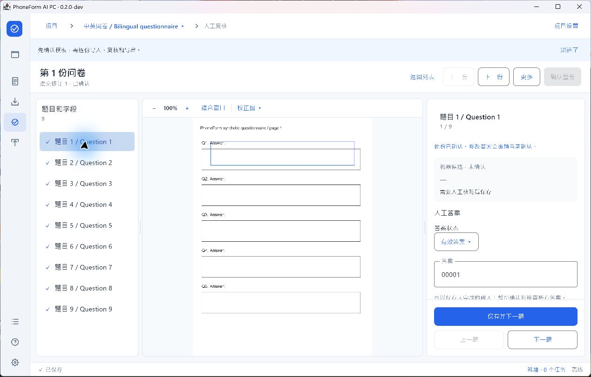

# PhoneForm AI PC 0.2.0-dev

Windows 11 x64 内部试用预览版 / Internal evaluation prerelease.

## 中文

- 全流程蓝白桌面改造：侧栏导航、面包屑、工具栏、保存/后台任务状态栏及明暗主题。
- 项目和问卷改为可搜索、筛选的数据表；三步项目向导与对话框保留固定操作栏。
- 模板、导入和覆核提供页面/题目导航、图像画布、属性/答案检查器；支持可调分栏及窄窗口图像/编辑切换。
- 覆核先显示问卷表格，再进入单份工作台；保留机器候选与人工答案的区分、保存后下一题及整份确认。
- Excel 分为输出设置、字段与列、历史快照；保留四表、隐私、精确文本和快照规则。
- 界面位置与布局偏好加密保存；增加保存失败导航保护和编辑恢复保护。
- **92 项不同自动化测试通过，零失败/错误/跳过。** 已抽查三语、明暗主题、窄窗口、快捷保存和重启恢复。
- 新生成的三语 30 份合成 Excel 均在 Microsoft Excel 16.0.20430.20182 原生打开，无修复提示；前导零和公式形状文本抽查通过，独立 XLSX 静态核对通过。
- 完整三语人工流程、100%/150%/200% DPI、新界面 1,000 份数据、干净 Windows 安装/升级及剩余故障矩阵仍待验收。此为内部试用版。

## English

- Complete blue-and-white desktop redesign with sidebar navigation, breadcrumbs, toolbars, save/job status and light/dark/system themes.
- Searchable project and questionnaire tables, a three-step project wizard and fixed dialog action bars.
- Template, import and review workspaces combine page/target navigation, an image canvas and contextual properties/answers. Adjustable panes and an image/editor switch support narrower windows.
- Review starts with a questionnaire table and opens a focused single-submission workspace. Machine candidates, human answers, save-and-next and whole-submission confirmation retain their existing rules.
- Export is organized into settings, fields/columns and snapshot history, preserving the four-sheet, privacy, exact-text and immutable-snapshot contracts.
- Encrypted presentation preferences, failed-save navigation protection and guarded edit recovery.
- **All 92 distinct automated tests passed, with no failures, errors or skips.** Selected three-language, theme, narrow-window, shortcut-save and restart-recovery checks passed.
- Three new 30-record synthetic workbooks opened in Microsoft Excel 16.0.20430.20182 without repair prompts. Leading-zero/literal-text checks and independent XLSX structural checks passed.
- Full three-language manual journeys, the 100%/150%/200% DPI matrix, 1,000 submissions in the new UI, clean-Windows installation/upgrade and remaining failure checks are pending. This is an internal evaluation build.

## Installer identity

| File | Bytes | SHA256 |
|---|---:|---|
| `PhoneForm-AI-PC-0.2.0-dev.msi` | 160411871 | `95a827947aa34afe1a1587f62656e41631fe901340861d0ba3ce4b0a5aa0c240` |

The matching `.sha256` file is attached to the Release. Windows Installer product version: `0.2.0`; application version: `0.2.0-dev`.

The MSI was built before the first Git import. The source tag publishes the retained 0.2.0-dev source state; no historical Git revision is claimed to have been embedded in the installer.

[Progress and limits](../../工作阶段.md) · [Build summary](../../output/validation/build-summary.json) · [UI checks](../../output/validation/uiux-0.2.0/acceptance.json) · [Native Excel checks](../../output/validation/uiux-0.2.0/excel-native.json) · [Independent XLSX checks](../../output/validation/uiux-0.2.0/xlsx-static.json)
